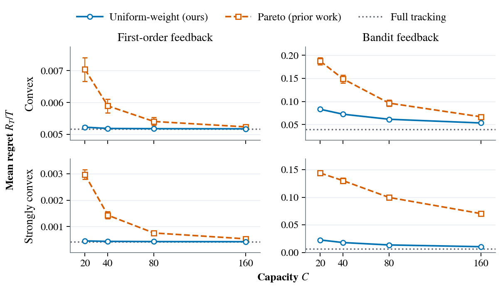

# Capacity-Constrained Online Convex Optimization

Code for **Capacity-Constrained Online Convex Optimization with Delayed Feedback**.

Compare uniform-weight Bernoulli scheduling, Pareto-type scheduling, and full
tracking under first-order and bandit feedback. Run the capacity ablation with
the paper settings or choose your own horizon and number of repetitions.

Run all commands below from the directory containing this README.

## Setup

Use Python 3.9-3.12 and a C++17 compiler (`clang++` or `g++`) on macOS or Linux.
The simulator compiles automatically on the first run. Plotting does not require
a LaTeX installation.

```bash
python3 -m venv .venv
.venv/bin/python -m pip install -r requirements.txt
```

## Reproduce the paper figure

### Figure 3: Capacity ablation

```bash
.venv/bin/python run.py --workers 4
```

<p align="center">
  
</p>

The experiment uses 100 paired repetitions, each with 1,000,000 rounds, and
capacities 20, 40, 80, and 160. The top row uses convex losses; the bottom row
adds a quadratic term to obtain strongly convex losses. Both families take
values in [0, 1]. Losses depend on heavy-tailed delays with mean 400, with the
directional learning signal carried by longer-delay rounds. Losses and delays
are fixed before play and shared across methods and capacities.

Markers show regret per round averaged across repetitions, with 95% confidence
intervals. Horizontal lines show full tracking, which is reused across capacities.

The command runs the simulations and writes the results and figure files to
`results/paper/`, creating the directory on the first run. Each completed
repetition is saved. Rerun the same command to reuse completed repetitions and
finish interrupted work. Adjust `--workers` to change parallelism, or use
`--output PATH` to choose another output directory.

## Run custom experiments

For a shorter experiment with both loss families:

```bash
.venv/bin/python run.py --horizon 100000 --seeds 5 \
    --workers 4 --output results/short
```

| Option | Use |
| --- | --- |
| `--horizon` | Rounds per run; at least 10,000 (default: 1,000,000) |
| `--seeds` | Paired repetitions, including a single repetition (default: 100) |
| `--workers` | Parallel repetitions (default: 1) |
| `--output` | Results directory (default: `results/paper`) |

Both loss families, feedback types, and the four paper capacities are always
included. Repetitions use consecutive seeds starting at 100. A single repetition
produces a plot without confidence intervals.

Use a separate `--output` directory when changing the horizon or number of
repetitions. Run `.venv/bin/python run.py --help` to see all options.

## Plot results

Each command generates its plots automatically after the experiment finishes.
After running an experiment, regenerate its plots without starting any simulations:

```bash
.venv/bin/python run.py --plot-only --output results/short
```

`--plot-only` uses the settings saved with the results. Each output directory
contains:

```text
config.json   Experiment settings
runs.csv      Per-run regret, losses, and tracking diagnostics
summary.json  Means and confidence intervals
figure3.pdf   Vector figure
figure3.png   Figure preview
```

## Project organization

```text
run.py            Run the capacity ablation and generate its figure
requirements.txt  Python dependencies
src/              Simulator, experiment runner, and plotting code
assets/           Figure preview shown in this README
results/          Runs and plots, created when an experiment is run
```
